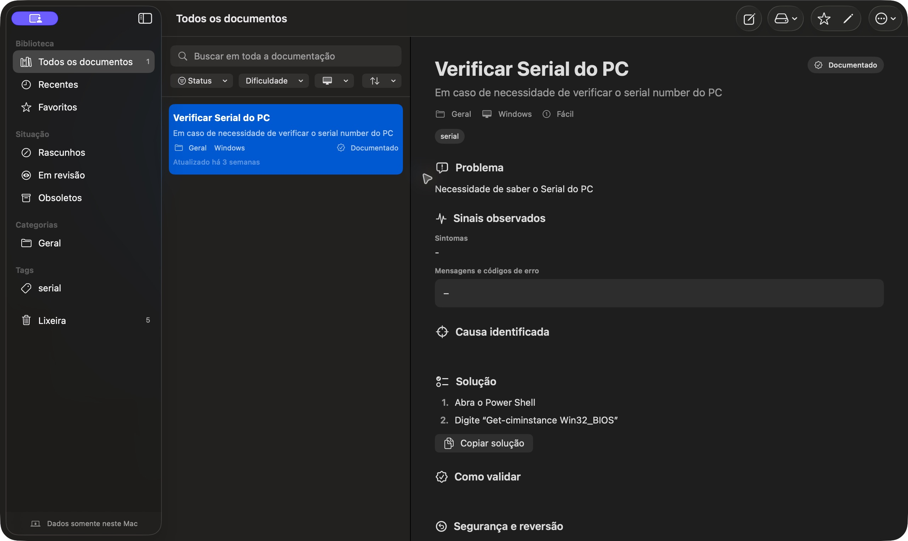

# Cdocs

**Uma base de conhecimento de suporte de TI, direto no Mac.**

O Cdocs é um aplicativo nativo para macOS que ajuda a registrar, encontrar e reutilizar soluções de problemas de TI. Em vez de deixar procedimentos espalhados em arquivos e anotações, ele reúne o problema, o diagnóstico, a solução e a validação em um mesmo lugar.

Desenvolvido com **Swift, SwiftUI e SwiftData**, funciona com armazenamento local e não depende de conta, servidor ou conexão com a internet para consultar a biblioteca.



*Biblioteca de procedimentos e visualização de uma documentação. A captura mostra um exemplo de consulta, sem dados de máquinas ou clientes.*

## Por que este projeto existe

Problemas de suporte podem se repetir, mas a solução nem sempre fica registrada de forma fácil de consultar. O Cdocs organiza esse conhecimento para que um procedimento possa ser encontrado e reaproveitado na próxima ocorrência.

Cada documentação pode reunir contexto, sintomas, mensagens de erro, sistema afetado, causa, passos de solução, forma de validar o resultado e orientações de reversão.

## Recursos

| Área | O que o aplicativo oferece |
| --- | --- |
| Documentação | Registro de problemas, diagnóstico, solução, validação, riscos, reversão e links úteis. |
| Pesquisa | Busca no conteúdo dos documentos, com tratamento de maiúsculas e acentos. |
| Organização | Categorias, tags, favoritos, recentes e filtros por situação, dificuldade e sistema afetado. |
| Procedimentos | Editor com Markdown e exibição de blocos de código copiáveis. |
| Acompanhamento | Histórico básico de alterações e contador de consultas. |
| Anexos | Arquivos locais de até 25 MB, selecionados pelo Finder ou por arrastar e soltar. |
| Recuperação | Lixeira com restauração e exclusão definitiva. |
| Portabilidade | Exportação em Markdown ou JSON, importação de JSON, impressão e PDF. |
| Backup | Cópia da biblioteca e dos anexos em uma pasta `.cdocsbackup`. |

A interface também oferece atalhos de teclado e suporte aos temas claro e escuro. Na primeira execução, o aplicativo cria cinco documentações fictícias para demonstração.

## Tecnologias e organização

- **Swift:** modelos, regras de validação e serviços do aplicativo.
- **SwiftUI e AppKit:** interface nativa, seleção de arquivos e integração com o macOS.
- **SwiftData:** persistência local de documentos, anexos e histórico.
- **XCTest:** testes automatizados dos serviços.

```text
Cdocs/
├── Models/              Modelos SwiftData e estado de edição
├── Services/            Pesquisa, validação, anexos, exportação, backup e impressão
├── Views/               Biblioteca, editor, detalhes e renderização Markdown
├── Assets.xcassets/     Ícone e recursos visuais
└── CdocsApp.swift       Entrada do aplicativo
CdocsTests/              Testes dos serviços
Cdocs.xcodeproj/         Projeto do Xcode
docs/images/            Captura da interface
```

A pesquisa e os filtros ficam separados das telas. Os serviços cuidam de tarefas como anexos, validação, exportação e backup, enquanto os modelos representam os documentos e seus relacionamentos.

## Como executar

### Requisitos

- macOS 14 ou posterior.
- Xcode 15 ou posterior, com SDK compatível com o projeto.
- Nenhuma dependência externa.

### Pelo Xcode

1. Clone o repositório e abra [Cdocs.xcodeproj](Cdocs.xcodeproj).
2. Selecione o esquema **Cdocs** e o destino **My Mac**.
3. Execute com **Command + R**.

### Pelo terminal

Na raiz do repositório:

```bash
xcodebuild -project Cdocs.xcodeproj \
  -scheme Cdocs \
  -configuration Debug \
  -derivedDataPath /tmp/CdocsDerivedData \
  CODE_SIGNING_ALLOWED=NO build
```

Se o sistema estiver usando somente as ferramentas de linha de comando, selecione a instalação completa do Xcode com `DEVELOPER_DIR=/Applications/Xcode.app/Contents/Developer` antes de executar o comando.

## Como usar

1. Crie uma documentação e preencha o título, o resumo e o contexto do problema.
2. Registre a solução em passos e explique como conferir o resultado.
3. Escolha categoria, tags, sistema afetado, dificuldade e situação.
4. Adicione anexos ou links quando ajudarem a entender o procedimento.
5. Use a pesquisa e os filtros para localizar o conteúdo depois.

Documentos podem ficar como **Rascunho**, **Documentado**, **Em revisão** ou **Obsoleto**. Use favoritos para os procedimentos consultados com mais frequência.

## Backup, importação e exportação

- **Backup completo:** use o menu de dados ou **Arquivo > Criar backup**. A pasta `.cdocsbackup` contém `documents.json` e os anexos.
- **Restauração:** escolha **Arquivo > Restaurar backup**. Registros com o mesmo identificador são preservados, sem substituição silenciosa.
- **Exportação individual:** use o menu de ações de uma documentação para gerar Markdown ou JSON.
- **Importação:** escolha **Dados > Importar documentação JSON**.
- **PDF:** abra **Imprimir** e selecione **Salvar como PDF** no painel do macOS.

O banco SwiftData fica na área de Application Support administrada pelo macOS. Os anexos são armazenados em `~/Library/Application Support/Cdocs/Attachments/`. Use os recursos de backup do aplicativo em vez de alterar esses arquivos manualmente.

## Testes

No Xcode, use **Command + U**. Pelo terminal:

```bash
xcodebuild -project Cdocs.xcodeproj \
  -scheme Cdocs \
  -configuration Debug \
  -derivedDataPath /tmp/CdocsDerivedData \
  CODE_SIGNING_ALLOWED=NO test
```

A suíte cobre pesquisa e filtros, lixeira, validação, serialização JSON, importação e exportação Markdown, além de cenários de backup e restauração. O histórico registra alterações básicas; não oferece comparação completa entre versões.

## Distribuição e cuidados com os dados

Para gerar uma versão distribuível, use **Product > Archive** no Xcode. Distribuição fora da App Store exige configurar a equipe Apple Developer, a assinatura Developer ID e a notarização.

Os dados ficam no Mac, mas documentos, anexos e backups ainda podem conter informações internas. Não registre senhas, tokens ou chaves. O controle de anexos valida tamanho e extensão; não substitui análise antimalware. O backup não possui criptografia própria nesta versão.

## Possíveis evoluções

- Pré-visualização do Markdown durante a edição.
- Destaque dos termos encontrados na busca.
- Comparação entre versões dos documentos.
- Testes automatizados da interface.
- Criptografia opcional dos backups.

## Autor

Projeto pessoal de **Caio Nolli**.

[GitHub](https://github.com/cnolli-fl) · [LinkedIn](https://www.linkedin.com/in/caio-nolli-843580388/)
